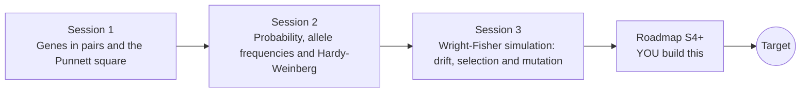

# opengenetics

[](https://github.com/KrunalPanchal1995/opengenetics/actions/workflows/ci.yml)   [](https://colab.research.google.com/github/KrunalPanchal1995/opengenetics/blob/main/sessions/session-01/lesson.ipynb) [](https://krunalpanchal1995.github.io/opengenetics/)

**Predict inheritance with Punnett squares, then watch genes drift and evolve.**

opengenetics teaches inheritance from one Punnett square to Hardy-Weinberg populations and a Wright-Fisher simulation of drift and natural selection, using only Python and a browser.

- **Start from one gene.** Session 1 needs only counting; the Punnett square does the thinking.
- **See it move.** Every session ships a slider app that runs in the browser, with labelled graphs.
- **Know you got it right.** Each session ends with a checkpoint that prints PASS or FAIL against hand calculations and formulas.
- **Build the missing half.** The repo stops at drift, selection and mutation on purpose; the roadmap shows the path to the Target.

[Target](#the-target) · [Who is this for](#who-is-this-for) · [Quick start](#quick-start) · [Sessions](#sessions) · [Roadmap](#roadmap) · [Contribute](#contribute) · [Explainer PDF](docs/explainer.pdf)

> **This repo is incomplete on purpose.** Sessions 1 to 3 are here and fully working. The finished Target below is a preview of what the community can build next. We show you the path, not the code. Sessions 4 and up are yours.

## The Target

On the left an Aa x Aa Punnett square fills in box by box while a running tally of simulated children settles near 3 dominant : 1 recessive. In the middle, 40 small populations of 40 individuals each start with a rare allele at frequency 0.1 and wander by chance: most lose it, a few take over. On the right the same allele has a 10 percent fitness advantage; the black curve shows what selection alone would do, and the grey-green paths show how drift scatters real populations around it. Your goal over the coming sessions: build all three panels yourself and compare selection with drift.


*Target: an Aa x Aa Punnett square, and allele-frequency paths under drift versus selection*


*Target: last frame, 600 simulated children and 40 populations per panel*


*Target extra: chance that a rare helpful allele takes over, by population size*

Try it live:

- [Math Visual Studio (Studio root)](https://krunalpanchal1995.github.io/studio/)

How the Target was made is shown only as a path in [promo/roadmap.md](promo/roadmap.md).

## Who is this for
**secondary school to diploma / undergraduate (levels 3-5).** Topic area: Biology, Human Body and Health Science.

Prerequisites:

- Fractions and simple probability (a coin flip has chance 1/2).
- Python 3.10 or newer; if `python --version` works, you are ready. PRIMER.md explains the rest.
- No prior biology, GitHub or statistics experience is needed.

New to Python? Read [PRIMER.md](PRIMER.md) first (10 minutes).

## Quick start

No installation knowledge needed. You need [Git](https://git-scm.com/downloads) and [Python 3.10+](https://www.python.org/downloads/) (Windows: tick "Add Python to PATH"). On Mac and Linux type `python3` wherever this page says `python`.

```bash
git clone https://github.com/KrunalPanchal1995/opengenetics.git
cd opengenetics
python start.py 1
```

`start.py` creates a private environment, installs what is needed and runs Session 1 with its checkpoint. Next: `python start.py 2`, `python start.py 3`, or `python start.py test` to check everything. Only a checkpoint: `python start.py check 1`.

Four lines turn the idea of Session 2 into a result (they work as they are): Save it as `try.py` and run it with `python start.py run try.py` (this uses the private environment, where NumPy is installed):

```python
import numpy as np
q = np.sqrt(1 / 10000)            # a recessive trait seen in 1 birth in 10,000: q squared = 0.0001
p = 1 - q                          # allele frequencies add to 1
print(round(q, 4), round(2 * p * q, 4))   # -> 0.01 0.0198  carriers: about 1 person in 50
```

Every session also opens in your browser with sliders (no install): [live apps](https://krunalpanchal1995.github.io/opengenetics/). Or use the Colab badge above for the notebook.

## Sessions

| # | Session | Model level | Time | Live app |
|---|---|---|---|---|
| 1 | [Genes in pairs and the Punnett square](sessions/session-01/README.md) | Level 1: conceptual interactive model | 60 min | [open](https://krunalpanchal1995.github.io/opengenetics/session-01/) |
| 2 | [Probability, allele frequencies and Hardy-Weinberg](sessions/session-02/README.md) | Level 2: mathematical engineering model | 75 min | [open](https://krunalpanchal1995.github.io/opengenetics/session-02/) |
| 3 | [Wright-Fisher simulation: drift, selection and mutation](sessions/session-03/README.md) | Level 3: simulation and validation | 90 min | [open](https://krunalpanchal1995.github.io/opengenetics/session-03/) |

Each session follows the same six steps: A real-world problem, B concept and theory, C visual explanation, D interactive simulation, E worked example and experiment, F assessment and design challenge. Each ends with `checkpoint.py`, which prints `PASS` or `FAIL` against reference numbers. Session 3 also contains the real-world mini-project: **How large must a conservation population be?**.

## Architecture



| Folder or file | What is inside |
|---|---|
| `sessions/` | three sessions: README (A-F), `lesson.py`, notebook, live app, exercises, activity sheet, checkpoint |
| `promo/` | the Target: media, live links, and the roadmap (path only) |
| `docs/` | `explainer.tex` and the built `explainer.pdf` |
| `tests/` | runs every lesson and checkpoint headless |
| `start.py` | one command to set up and run anything |
| `QUALITY.md`, `RUBRIC.md` | the quality checklist and the scoring rubric |
| `.github/` | CI, PDF build, Pages deploy, issue and PR templates |

## Roadmap

| Milestone | What you will build | Difficulty |
|---|---|---|
| Session 4: Selfing and inbreeding | A simulator of repeated selfing starting from one Aa individual. | intermediate |
| Session 5: Unequal sex ratio and effective size | A Wright-Fisher model with separate sexes. | intermediate |
| Session 6: Linked genes and recombination | A two-gene gamete simulator with a recombination fraction. | advanced |
| Session 7: Heterozygote advantage | Selection with fitness AA 0.8, Aa 1, aa 0.6 and drift in a large population. | advanced |
| Session 8: Reproduce the Target | A three-panel animation like the Target, from your own code. | advanced |

Full detail with a checkpoint per milestone: [promo/roadmap.md](promo/roadmap.md).

## Contribute
New to GitHub? Read [CONTRIBUTING.md](CONTRIBUTING.md); it starts from zero. Pick an issue labelled `good first issue`. Translations into Hindi, Telugu, Tamil and Malayalam are welcome.

<details>
<summary>Development</summary>

```bash
python start.py test        # runs every lesson and checkpoint
```
Lessons use `# %%` cell markers so they open as notebooks in VS Code. See [QUALITY.md](QUALITY.md) for the standard every session meets.
</details>

## License
MIT. See [LICENSE](LICENSE). Media in `promo/media` is (c) Krunal Panchal, CC BY 4.0.

## Acknowledgments
Part of the [PAN IIT OSS](https://hellofoss.tech-iitb.org/projects) open-source teaching collection, modelled on the structure of [openspline](https://github.com/openspline/openspline). Built on ideas from the Math Visual Studio at https://krunalpanchal1995.github.io/studio/.
