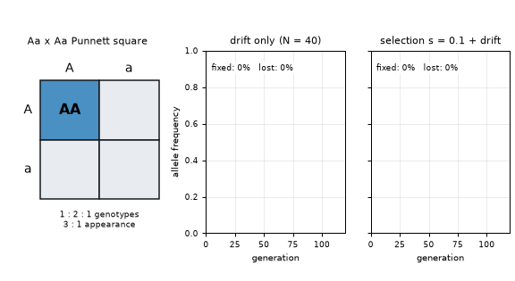
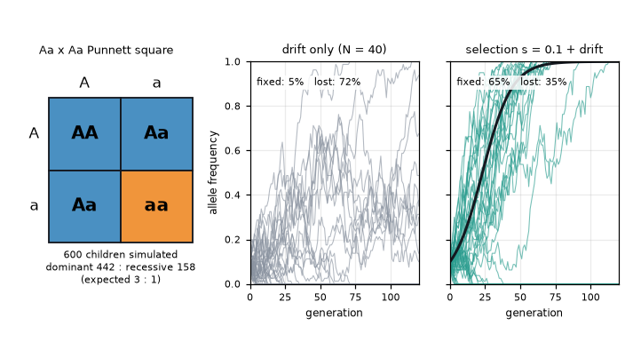
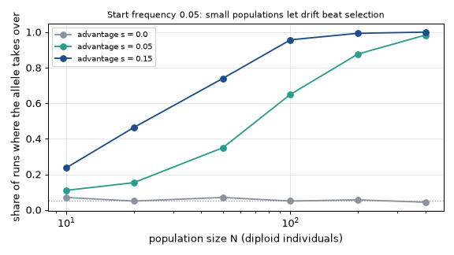

# What you are building toward

On the left an Aa x Aa Punnett square fills in box by box while a running tally of simulated children settles near 3 dominant : 1 recessive. In the middle, 40 small populations of 40 individuals each start with a rare allele at frequency 0.1 and wander by chance: most lose it, a few take over. On the right the same allele has a 10 percent fitness advantage; the black curve shows what selection alone would do, and the grey-green paths show how drift scatters real populations around it. Your goal over the coming sessions: build all three panels yourself and compare selection with drift.

*Target: an Aa x Aa Punnett square, and allele-frequency paths under drift versus selection*

*Target: last frame, 600 simulated children and 40 populations per panel*

*Target extra: chance that a rare helpful allele takes over, by population size*

These results come from a private reference build. The code is not published; the roadmap shows the path so you can build your own.

Live links:

- [Math Visual Studio (Studio root)](https://krunalpanchal1995.github.io/studio/)
