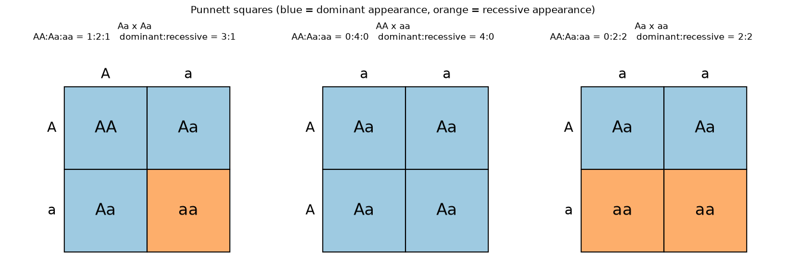
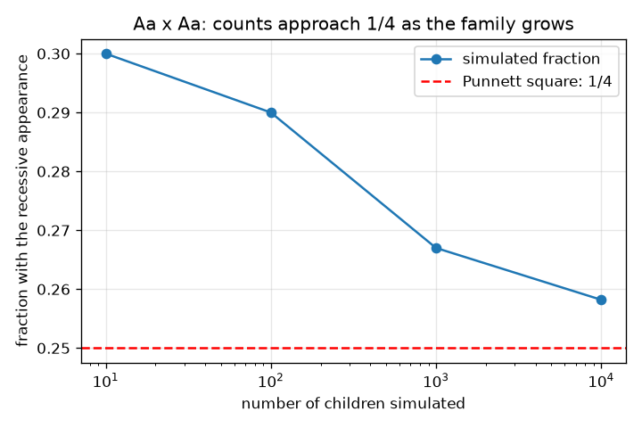

# Session 1: Genes in pairs and the Punnett square

*Level 1 (conceptual interactive model) · about 60 minutes · opengenetics*

> This is a simplified educational model. It is not a validated design tool and must not be used for real structures, electrical installations, vehicles, industrial processes or medical decisions.

**Prerequisites**

- Counting and simple fractions.
- You have read PRIMER.md and run `python start.py 1` once.

**Learning objectives.** After this session you can:

- Explain that a gene comes in pairs of alleles, one from each parent.
- Tell genotype (AA, Aa, aa) from phenotype (appearance), and dominant from recessive.
- Fill in a Punnett square and read off the genotype and appearance ratios.
- Check a ratio with a seeded simulation and explain why small families vary.

## A. Real-world problem
Two parents both show the dominant trait, yet one of their children shows the recessive trait. Is that possible? A Punnett square answers it by listing every equally likely combination of alleles. This is a simplified textbook model of one gene; it is general education and says nothing about any real person or family, and it is not medical or genetic advice.

## B. Concept and theory
A gene can have versions called alleles. A child receives one allele from each parent, so each child has a pair. Write the dominant allele A and the recessive allele a. The genotype is the pair (AA, Aa or aa); the phenotype is the appearance. A dominant appearance needs at least one A; the recessive appearance needs aa. Each parent passes on one of their two alleles with equal chance 1/2. A Punnett square puts one parent's two alleles on the rows and the other's on the columns; its four boxes are the four equally likely children. For Aa x Aa the boxes are AA, Aa, Aa, aa, so genotypes are 1 : 2 : 1 and appearances are 3 dominant : 1 recessive.

| Symbol | Meaning | Unit |
|---|---|---|
| A | dominant allele | no unit |
| a | recessive allele | no unit |
| genotype | the pair of alleles (AA, Aa, aa) | no unit |
| phenotype | the visible trait: dominant or recessive | no unit |
| n | number of children simulated | count |

**Assumptions**

- One gene with two alleles and complete dominance.
- Each parent passes on either allele with probability 1/2.
- Each child is independent of the others.
- General education model; it does not describe any real person.

$$ P(\text{child is } aa)=\tfrac12\times\tfrac12=\tfrac14 $$

$$ \text{Aa}\times\text{Aa}:\quad AA:Aa:aa = 1:2:1,\qquad \text{dominant}:\text{recessive}=3:1 $$

## C. Visual explanation
The first figure shows three Punnett squares (Aa x Aa, AA x aa, Aa x aa) with the boxes coloured by appearance and the counts printed above each. The second figure shows the fraction of recessive children in simulated families of 10, 100, 1000 and 10000 children: small families wander far from 1/4, large ones settle close to the dashed 1/4 line.

*Three Punnett squares with genotype and appearance counts; blue boxes show the dominant appearance, orange the recessive.*

*Aa x Aa: the simulated fraction of recessive children approaches 1/4 as the family grows.*

## D. Interactive simulation
Run the lesson (`python start.py 1`), then open the live app: [Session 1: the Punnett square](https://krunalpanchal1995.github.io/opengenetics/session-01/) (or `app.html` in this folder). Choose the genotype of each parent with the two sliders and watch the Punnett square and the probability bars change. Try AA x aa and Aa x aa.

**Challenge.** Find the cross that gives 3 dominant : 1 recessive.

## E. Worked example and experiment
**Problem.** Both parents are Aa. List the possible children and state the genotype and appearance ratios.

1. Parent 1 can pass A or a; parent 2 can pass A or a. Put them on the rows and columns.
2. The four boxes are AA, Aa, aA (written Aa) and aa.
3. Genotype counts: AA 1, Aa 2, aa 1, so the ratio is 1 : 2 : 1.
4. Appearance: AA and both Aa show the dominant trait (3 boxes); only aa shows the recessive trait (1 box), so the ratio is 3 : 1.
5. Each box has probability 1/4, so each child has probability 1/4 of being aa.

**Answer.** Genotypes 1 AA : 2 Aa : 1 aa; appearance 3 dominant : 1 recessive; P(aa) = 1/4 for each child.

**Experiment.** Flip two coins for each child (heads = A, tails = a, one coin per parent) and record 40 children. Count how many show two tails. Expect about 10, but not exactly: with few children the count varies a lot, which is the same scatter you see in the left of the second figure. The model is exact; a small family is just a small sample, and real traits can involve more genes and the environment.

## F. Assessment and design challenge
**Question type A: Conceptual.** Two parents both show the dominant trait and have a child with the recessive trait. What must the genotypes of the parents be? Why?

Hint

A recessive child is aa, so it received an a from each parent.

Step-by-step solution

The child is aa, so each parent passed on an a. A parent who shows the dominant trait must also carry an A, so each parent is Aa. Both parents are carriers of the recessive allele without showing it.

**Question type B: Numerical.** For the cross AA x Aa, fill in the Punnett square and give the genotype counts and the chance that a child shows the recessive appearance.

Hint

Parent 1 can pass only A. Parent 2 passes A or a.

Step-by-step solution

The four boxes are AA, Aa, AA, Aa, so AA : Aa : aa = 2 : 2 : 0. Every child has at least one A, so the chance of the recessive appearance is 0. Sanity check: the four counts add up to 4.

**Question type C: Graph and simulation interpretation.** In the second figure, why does the fraction of recessive children jump around for 10 children but sit close to 1/4 for 10000?

Hint

Think about how much one child changes a fraction when the family is small and large.

Step-by-step solution

With 10 children one child changes the fraction by 0.1, so it is easy to land far from 1/4 by chance. With 10000 children one child changes it by 0.0001, and the random ups and downs average out. The Punnett square gives the probability for each child, not the exact count for a small family.

**Question type D: Design and optimisation challenge.** Design: you cross two plants and want about half of the offspring to show the recessive appearance. Which parent genotypes would you choose, and why not the other choices?

Hint

Test the three possible pairings that include a recessive parent, and use the square.

Step-by-step solution

Choose Aa x aa: the boxes are Aa, aa, Aa, aa, so half the children are aa (a 1 : 1 ratio). AA x aa gives no recessive children (all Aa) and aa x aa gives only recessive children. Aa x Aa gives only a quarter. Trade-off and assumption: a real cross also needs enough offspring (a small number varies a lot) and a trait that really follows simple dominance.

Score yourself with [RUBRIC.md](../../RUBRIC.md). Print the [activity sheet](activity_sheet.md) to work on paper.

## Common misconceptions
| Common misconception | What is actually true |
|---|---|
| A dominant allele is the most common one. | Dominant only means it shows when one copy is present. How common an allele is in a population is a separate question (Session 2). |
| If a family has three dominant children, the next one must be recessive. | Each child is independent: the chance is 1/4 every time, the square gives probabilities, not a guaranteed pattern. |
| Aa x Aa always gives exactly 3 : 1 in a real family. | The 3 : 1 ratio is the long-run expectation; small families vary a lot. |
| Aa and aA are different genotypes. | They are the same genotype; the order does not matter, only which alleles are present. |

## Glossary
- **allele**: one version of a gene
- **genotype**: the pair of alleles an individual has, such as Aa
- **phenotype**: the visible trait that results
- **dominant**: an allele whose trait shows when at least one copy is present
- **recessive**: an allele whose trait shows only when two copies are present
- **Punnett square**: a table of the equally likely allele combinations from two parents

## Finish
1. Do the three coding tasks in [exercises.md](exercises.md).
2. Run `python start.py 1` again after your changes. It ends with the checkpoint; when it prints `PASS`, you are done. (Checkpoint only: `python start.py check 1`.)

Next: [Session 2](../session-02/README.md)
