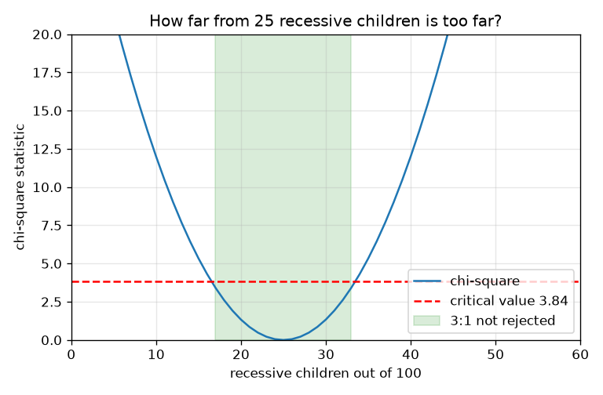
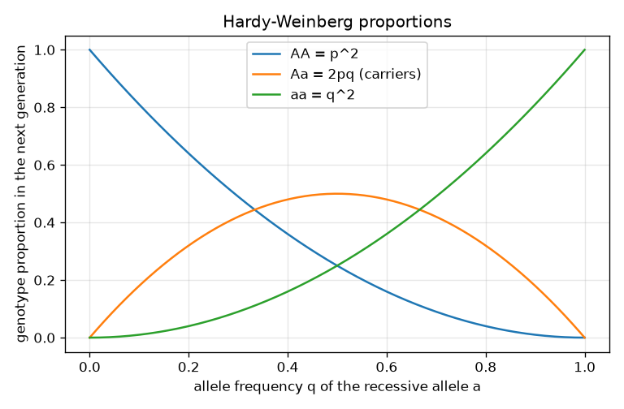

# Session 2: Probability, allele frequencies and Hardy-Weinberg

*Level 2 (mathematical engineering model) · about 75 minutes · opengenetics*

> This is a simplified educational model. It is not a validated design tool and must not be used for real structures, electrical installations, vehicles, industrial processes or medical decisions.

**Prerequisites**

- Session 1: Punnett squares.
- Probability of independent events (coin flips).

**Learning objectives.** After this session you can:

- Apply the multiplication and addition rules to inheritance.
- Use allele frequencies p and q with p + q = 1 and the Hardy-Weinberg proportions p^2, 2pq, q^2.
- Compute the carrier proportion from the rate of a recessive trait.
- Test a 3:1 ratio with a chi-square statistic and the 3.84 critical value.
- Extend to two genes: the 9:3:3:1 dihybrid ratio.

## A. Real-world problem
A recessive trait appears in about 1 birth in 10,000. How many people carry one copy of the allele without showing the trait? Counting boxes in a Punnett square no longer helps, because the parents are not chosen: we need the frequency of each allele in a whole population. And when a breeder counts offspring, how far from 3 : 1 is too far? General education in an idealised model; it is not medical or genetic advice about any person.

## B. Concept and theory
The rules are the ones from coin flips. Multiplication rule: for independent events, P(first and second) = P(first) x P(second). Addition rule: for events that cannot both happen, P(first or second) = P(first) + P(second). In Aa x Aa each parent passes a with probability 1/2, so P(aa) = 1/2 x 1/2 = 1/4, and P(Aa) = 1/4 + 1/4 = 1/2 (A from parent 1 and a from parent 2, or the other way round). In a population let p be the fraction of all alleles that are A and q the fraction that are a; then p + q = 1. If mating is random, there is no selection, no migration, no mutation and the population is large, the genotype proportions are p^2 (AA), 2pq (Aa) and q^2 (aa), and they add to (p + q)^2 = 1. This is the Hardy-Weinberg model, a baseline to compare real populations against. For a recessive trait seen in a fraction r of births, q = sqrt(r). To test counts against a 3:1 ratio, compute chi-square = sum of (observed - expected)^2 / expected; for two categories (1 degree of freedom) the standard table value for the 5 percent level is 3.84, and a larger statistic means the 3 : 1 ratio is doubted. For two genes inherited independently multiply the single-gene ratios: (3 : 1) x (3 : 1) = 9 : 3 : 3 : 1.

| Symbol | Meaning | Unit |
|---|---|---|
| p | frequency of allele A | no unit (0 to 1) |
| q | frequency of allele a | no unit (0 to 1) |
| r | frequency of the recessive appearance (aa) | no unit |
| O, E | observed and expected counts in a category | count |
| chi2 | chi-square statistic | no unit |
| n | number of offspring counted | count |

**Assumptions**

- Random mating, no selection, no migration, no mutation, and a large population (Hardy-Weinberg).
- One gene with two alleles and complete dominance.
- Offspring counts are independent and the expected counts are not tiny.
- The 3.84 value is a standard table entry for 1 degree of freedom at the 5 percent level.
- General education model only.

$$ P(A\text{ and }B)=P(A)P(B),\qquad P(A\text{ or }B)=P(A)+P(B)\ \ (\text{exclusive}) $$

$$ p+q=1,\qquad p^2+2pq+q^2=(p+q)^2=1 $$

$$ q=\sqrt{r},\qquad \text{carriers}=2pq $$

$$ \hat q=\frac{2n_{aa}+n_{Aa}}{2\,(n_{AA}+n_{Aa}+n_{aa})} $$

$$ \chi^2=\sum\frac{(O-E)^2}{E},\qquad \chi^2<3.84\ \Rightarrow\ \text{3:1 not rejected at the 5\% level} $$

## C. Visual explanation
The first figure plots the three Hardy-Weinberg proportions against q: AA falls from 1 to 0, aa rises from 0 to 1, and the carrier curve 2pq peaks at 0.5 when q = 0.5. Notice how small q makes aa tiny while carriers stay much more common. The second figure plots chi-square against the number of recessive children out of 100: it is a parabola with its minimum at 25, and the shaded band between 17 and 33 is where the 3 : 1 ratio is not rejected (the statistic stays below 3.84).

*Chi-square against the recessive count out of 100: below 3.84 for 17 to 33 recessive children.*

*Hardy-Weinberg proportions against q: AA, carriers 2pq (peak 0.5 at q = 0.5) and aa.*

## D. Interactive simulation
Run the lesson (`python start.py 2`), then open the live app: [Session 2: Hardy-Weinberg and chi-square](https://krunalpanchal1995.github.io/opengenetics/session-02/) (or `app.html` in this folder). Move the q slider and watch the bar split into AA, carriers and aa. Open the chi-square view, set 100 children and move the observed recessive percentage until the dot rises above the red line.

**Challenge.** Set q so that carriers are at least 0.42 of the population, and choose an observed recessive percentage that makes the 3:1 ratio get rejected for the chosen number of children.

## E. Worked example and experiment
**Problem.** A recessive trait is present in 1 birth in 10,000. Find q, p and the carrier proportion 2pq.

1. q^2 = 1 / 10,000 = 0.0001.
2. q = sqrt(0.0001) = 0.01, so p = 1 - 0.01 = 0.99.
3. Carriers: 2pq = 2 x 0.99 x 0.01 = 0.0198.
4. 1 / 0.0198 is about 50, so roughly 1 person in 50 carries one copy, although only 1 in 10,000 shows the trait.
5. Check: p^2 + 2pq + q^2 = 0.9801 + 0.0198 + 0.0001 = 1.

**Answer.** q = 0.01, p = 0.99 and carriers 2pq = 0.0198 (about 1 in 50). Most copies of a rare recessive allele are hidden in carriers.

**Experiment.** Roll two dice or draw coloured beads from a jar to model a population: a jar with 99 white (A) and 1 black (a) beads per 100, draw two beads for each 'individual' for 2000 individuals and count those with one black bead. Expect about 2 percent. The model differs from reality: real populations are not perfectly random-mating, mutation and selection act, and the trait may have several causes, so Hardy-Weinberg is a baseline rather than a measurement.

## F. Assessment and design challenge
**Question type A: Conceptual.** Why do most copies of a rare recessive allele sit in carriers (Aa) rather than in people showing the trait (aa)?

Hint

Compare 2pq with q^2 when q is small.

Step-by-step solution

When q is small, q^2 is much smaller than 2pq (with q = 0.01, q^2 = 0.0001 and 2pq = 0.0198). The allele is rarely paired with another copy of itself, so nearly all copies are in Aa individuals, hidden from view.

**Question type B: Numerical.** A recessive trait has frequency 1 in 2,500. Find q and the carrier proportion. Sanity check the result.

Hint

q = sqrt(1/2500); carriers 2pq.

Step-by-step solution

q = sqrt(0.0004) = 0.02, p = 0.98, carriers = 2 x 0.98 x 0.02 = 0.0392 (about 1 in 26). Sanity check: carriers are roughly 2q = 0.04 when q is small, and 0.0392 is close to that.

**Question type C: Graph and simulation interpretation.** In the chi-square graph for 100 children, what range of recessive counts keeps the 3:1 ratio, and why is the curve lowest at 25?

Hint

Read where the curve crosses the red line, and ask what the expected count is.

Step-by-step solution

From 17 to 33 recessive children the statistic stays below 3.84. The minimum is at 25 because the expected recessive count is 0.25 x 100 = 25, where observed equals expected and chi-square is 0. Both sides rise because larger mismatches are squared.

**Question type D: Design and optimisation challenge.** Design: a breeder counts 740 dominant and 260 recessive offspring of 1000 and suspects 3:1. Test it. Then say what range of recessive counts out of 1000 would be accepted, and why a bigger sample is a stronger test.

Hint

Expected counts are 750 and 250. Use chi-square with the 3.84 limit; the same method gave 17 to 33 for 100 children.

Step-by-step solution

chi-square = (740 - 750)^2 / 750 + (260 - 250)^2 / 250 = 0.133 + 0.400 = 0.533, below 3.84, so 3:1 is not rejected. For 1000 children the accepted recessive counts are 224 to 276, a band of 53 values (about 22 percent to 28 percent), narrower in relative terms than 17 to 33 percent for 100 children, so a larger sample can detect smaller departures. Assumptions: independent offspring and a simple one-gene model; not rejecting 3:1 does not prove it.

Score yourself with [RUBRIC.md](../../RUBRIC.md). Print the [activity sheet](activity_sheet.md) to work on paper.

## Common misconceptions
| Common misconception | What is actually true |
|---|---|
| Dominant alleles become more common over generations. | In Hardy-Weinberg, allele frequencies do not change at all without selection, drift, migration or mutation. Dominance is about appearance, not frequency. |
| If a trait is rare, so is the allele that causes it. | A rare recessive trait can have a much more common carrier state: for q = 0.01 the trait is 1 in 10,000 but carriers are about 1 in 50. |
| A chi-square below 3.84 proves the ratio is 3:1. | It only says the data are not strong enough to reject 3:1 at the 5 percent level. |
| Hardy-Weinberg describes real populations exactly. | It is a baseline built on five assumptions; departures from it are what teach us about selection, drift and mating. |

## Glossary
- **allele frequency**: the fraction of all copies of a gene that are one particular allele
- **Hardy-Weinberg proportions**: p^2, 2pq, q^2: genotype fractions under random mating with no evolutionary forces
- **carrier**: someone with one copy of a recessive allele who does not show the trait
- **chi-square**: a measure of how far observed counts are from expected counts
- **critical value**: the table threshold (3.84 for 1 degree of freedom at 5 percent) above which we doubt the model
- **dihybrid cross**: a cross that follows two genes at once

## Finish
1. Do the three coding tasks in [exercises.md](exercises.md).
2. Run `python start.py 2` again after your changes. It ends with the checkpoint; when it prints `PASS`, you are done. (Checkpoint only: `python start.py check 2`.)

Next: [Session 3](../session-03/README.md)
