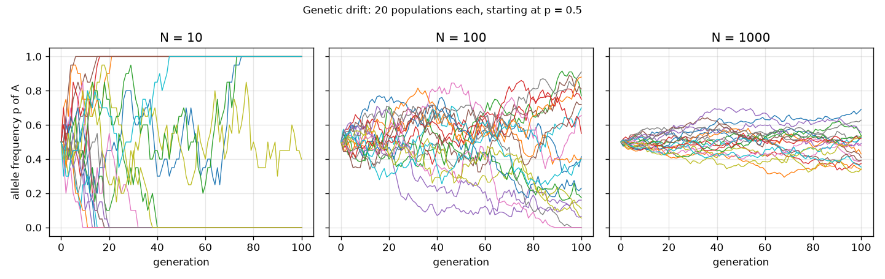
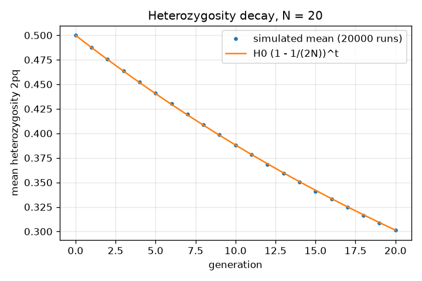
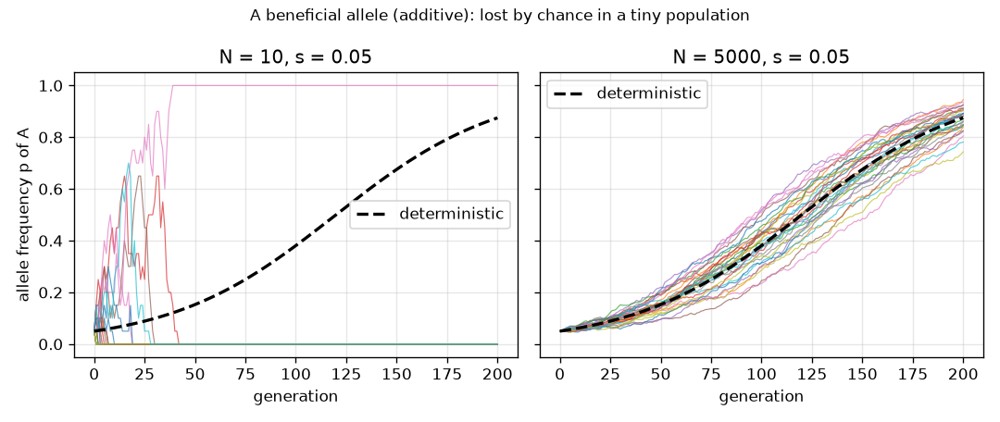

# Session 3: Wright-Fisher simulation: drift, selection and mutation

*Level 3 (simulation and validation) · about 90 minutes · opengenetics*

> This is a simplified educational model. It is not a validated design tool and must not be used for real structures, electrical installations, vehicles, industrial processes or medical decisions.

**Prerequisites**

- Session 2: allele frequencies and Hardy-Weinberg.
- Random numbers and the binomial idea (counting successes in n tries).

**Learning objectives.** After this session you can:

- Simulate allele frequencies in a finite population with a seeded generator.
- Show that small populations drift faster, that fixation probability equals the start frequency, and that heterozygosity decays by (1 - 1/(2N)) per generation.
- Add selection and mutation using stated update formulas, and validate against closed forms.
- Explain the failure case: a beneficial allele lost by chance in a tiny population.
- Size a conservation population from the heterozygosity formula and check it by simulation.

## A. Real-world problem
In a small population a gene version can vanish, or take over, purely by luck, even if it helps survival. In a large population the same helpful version spreads steadily. How small is too small, and how large must a captive breeding population be to keep most of its genetic variety for 50 generations? This is an idealised classroom model for general education. It is not a tool for real conservation decisions and says nothing about any person.

## B. Concept and theory
Wright-Fisher model: N diploid individuals carry 2N alleles. Each generation does three steps: selection and mutation change the expected frequency, then random mating draws the next 2N alleles independently, so the number of A alleles is Binomial(2N, p) and the new frequency is that number divided by 2N. That random sampling is genetic drift: it has no direction but changes frequencies by about sqrt(p q / (2N)) per generation, so small populations drift faster. Heterozygosity H = 2pq falls on average by the factor (1 - 1/(2N)) each generation, so E[H_t] = H_0 (1 - 1/(2N))^t. A neutral allele at frequency p_0 eventually takes over (fixes) with probability p_0 and is lost with probability 1 - p_0. Selection: fitness of AA, Aa, aa is 1 + s, 1 + h s, 1; the update is p' = [p^2 (1 + s) + p q (1 + h s)] / wbar with mean fitness wbar = p^2 (1 + s) + 2 p q (1 + h s) + q^2 (h = 1/2 additive, h = 1 dominant advantage, h = 0 recessive advantage). A simple haploid-like advantage uses p' = p (1 + s) / (1 + s p), whose closed form is logit(p_t) = logit(p_0) + t ln(1 + s). Mutation as a small constant flow: p' = p (1 - mu) + (1 - p) nu, settling at p* = nu / (mu + nu). In the simulation each generation applies selection, then mutation, then drift.

| Symbol | Meaning | Unit |
|---|---|---|
| N | number of diploid individuals | count |
| p, q | frequency of A and a (p + q = 1) | no unit |
| s | fitness advantage of A | no unit |
| h | dominance of the advantage (0 to 1) | no unit |
| mu, nu | mutation rates A to a, and a to A, per generation | per generation |
| H | heterozygosity 2pq | no unit |
| t | generation number | generations |

**Assumptions**

- Constant population size N, random mating (selfing allowed), non-overlapping generations.
- Selection acts before mating, mutation rates are constant and small.
- No migration and no population structure; N means an idealised (effective) size.
- General education model; not a validated conservation design tool.

$$ n_A\sim\mathrm{Binomial}(2N,\,p),\qquad p_{t+1}=n_A/(2N) $$

$$ E[H_t]=H_0\left(1-\frac{1}{2N}\right)^{t} $$

$$ p'=\frac{p^2(1+s)+pq(1+hs)}{p^2(1+s)+2pq(1+hs)+q^2} $$

$$ p'=\frac{p(1+s)}{1+sp},\qquad \mathrm{logit}\,p_t=\mathrm{logit}\,p_0+t\ln(1+s) $$

$$ p'=p(1-\mu)+(1-p)\nu,\qquad p^*=\frac{\nu}{\mu+\nu} $$

$$ N_{\min}=\min\left\{N:\ \left(1-\frac{1}{2N}\right)^{50}\ge 0.9\right\} $$

## C. Visual explanation
The first figure shows 20 populations at N = 10, 100 and 1000 all starting at p = 0.5: the N = 10 paths hit 0 or 1 quickly, the N = 1000 paths stay close together. The second figure compares the mean heterozygosity of 20000 simulated populations (N = 20) with the formula H_0 (1 - 1/(2N))^t; the dots sit on the curve. The third figure shows a beneficial allele (s = 0.05) starting at 0.05: at N = 10 most paths fall to 0 although the dashed deterministic curve rises, at N = 5000 every path follows the curve to 1.

*Twenty populations each at N = 10, 100 and 1000, starting at p = 0.5: smaller populations drift faster.*

*Mean heterozygosity of 20000 simulated populations (N = 20) follows H0 (1 - 1/(2N))^t.*

*A beneficial allele (s = 0.05, start 0.05): lost by chance at N = 10, follows the deterministic curve at N = 5000.*

## D. Interactive simulation
Run the lesson (`python start.py 3`), then open the live app: [Session 3: drift versus selection](https://krunalpanchal1995.github.io/opengenetics/session-03/) (or `app.html` in this folder). Change N, s and the starting frequency and watch 12 seeded populations. Compare the grey paths with the blue deterministic curve, then open the heterozygosity view and compare the dots with the formula.

**Challenge.** Pick N so that a pure-drift population keeps at least 90 percent of its heterozygosity for 50 generations.

## E. Worked example and experiment
**Problem.** (a) With s = 0.10 haploid-like selection and p = 0.10, find p' after one generation. (b) For N = 20 and p_0 = 0.5, find the expected heterozygosity after 20 generations of drift, and check it with the simulation.

1. (a) p' = p (1 + s) / (1 + s p) = 0.10 x 1.10 / (1 + 0.01) = 0.11 / 1.01 = 0.1089.
2. (b) H_0 = 2 x 0.5 x 0.5 = 0.5. The factor per generation is 1 - 1/40 = 0.975.
3. After 20 generations: 0.5 x 0.975^20 = 0.5 x 0.6027 = 0.3013.
4. Simulation: average 2pq over 20000 seeded populations after 20 generations; it gives 0.3016.
5. The two agree to three decimal places, as expected for a large number of runs.

**Answer.** (a) p' = 0.1089. (b) Expected heterozygosity 0.3013 against a simulated 0.3016: drift has removed about 40 percent of the variety in 20 generations at N = 20.

**Experiment.** Use a jar of 40 beads (20 white A, 20 black a): each generation draw 40 beads with replacement to make the next jar of 40, repeating for 20 generations, for several jars. Some jars will turn all one colour, as in the N = 10 and N = 20 panels. The model differs from real life: real populations have unequal numbers of males and females, overlapping generations and migration, so the real effective size is usually smaller than the head count.

## Real-world application and mini-project: How large must a conservation population be?
A small captive population is managed to keep its genetic variety. Using the Wright-Fisher model of Session 3 (constant size, random mating, no selection, no migration, no mutation), find the smallest population size N (diploid individuals) that keeps at least 90 percent of the starting heterozygosity for 50 generations. This is a classroom model: real conservation planning uses effective population sizes, sex ratios and many more facts.

**Deliverable:** A script that prints, for N = 100, 200, 237, 238 and 300, the formula value of (1 - 1/(2N))^50 and the mean simulated fraction of heterozygosity kept (at least 5000 seeded runs, starting at p = 0.5), names the smallest N whose formula value is at least 0.9, and saves a plot of heterozygosity kept against N.

**Success looks like:** The smallest N reported is 238 (formula value 0.9002; N = 237 gives 0.8998), and the simulated fractions agree with the formula to within 0.02.

## F. Assessment and design challenge
**Question type A: Conceptual.** A helpful allele is lost in a very small population even though selection favours it. Does this mean selection did not work? Explain.

Hint

Compare the size of the selection push with the random drift each generation.

Step-by-step solution

Selection still pushes the expected frequency up, but when N is tiny the random drift per generation is much larger than the push, so chance dominates and the allele is often lost early, after which selection cannot bring it back. Selection works on average; drift decides individual cases when N is small. In the simulation the same s = 0.05 allele is lost in about 93 percent of runs at N = 10 and never lost at N = 5000.

**Question type B: Numerical.** A population has N = 50 and a neutral allele. What fraction of heterozygosity is expected after 10 generations? Check the units and sanity.

Hint

Multiply the per-generation factor (1 - 1/(2N)) ten times.

Step-by-step solution

The factor is 1 - 1/100 = 0.99, and 0.99^10 = 0.9044, so about 90 percent is kept (about 10 percent is lost). H is a pure number with no unit. Sanity check: ten generations at a loss of 1 percent each should lose about 10 percent, and it does.

**Question type C: Graph and simulation interpretation.** In the N = 10 and N = 5000 panels of the selection figure, what do the grey paths and the dashed curve tell you? What is the spread of p after 20 generations at N = 10 and N = 1000?

Hint

Compare how closely the paths follow the dashed curve, and read the spread from the drift figure.

Step-by-step solution

At N = 5000 the paths hug the deterministic curve, so selection is nearly predictable. At N = 10 the paths scatter and most end at 0, so drift can overrule selection. The spread (standard deviation) of p after 20 generations starting at 0.5 is about 0.4 at N = 10 and about 0.05 at N = 1000, which is why larger populations are more predictable.

**Question type D: Design and optimisation challenge.** Design: what is the smallest N (diploid individuals) that keeps at least 90 percent of the heterozygosity for 50 generations, and how could you check it? Name two reasons the real number would be larger.

Hint

Solve (1 - 1/(2N))^50 >= 0.9, using ln, then check integers near the answer.

Step-by-step solution

Taking logs: 50 ln(1 - 1/(2N)) >= ln 0.9, so 1 - 1/(2N) >= 0.9^(1/50) = 0.997895, which gives N >= 237.5, so N = 238. Check: N = 238 gives 0.9002 and N = 237 gives 0.8998. A simulation at N = 238 with 5000 seeded runs keeps about 0.90 of H (0.898 in the checkpoint). The real number would be larger because the effective size is smaller than the head count (unequal sex ratio, uneven family sizes), and because mutation and migration are ignored while the target may be stricter than 90 percent.

Score yourself with [RUBRIC.md](../../RUBRIC.md). Print the [activity sheet](activity_sheet.md) to work on paper.

## Common misconceptions
| Common misconception | What is actually true |
|---|---|
| Natural selection always wins. | Selection wins on average in large populations; in small ones drift can remove a helpful allele by chance. |
| Drift pushes allele frequency in a direction. | Drift has no direction; it is a random walk that ends at 0 or 1, and it is stronger when N is small. |
| A neutral allele at frequency 0.3 will stay near 0.3. | It wanders and eventually fixes with probability 0.3 or is lost with probability 0.7 (the simulation gives about 0.29 fixed for N = 10). |
| Heterozygosity loss needs selection. | Pure drift alone removes a fraction 1/(2N) of the expected heterozygosity each generation. |

## Glossary
- **genetic drift**: random change in allele frequency because only a finite sample of alleles is passed on
- **fixation**: an allele reaching frequency 1 so every individual carries it
- **heterozygosity**: the fraction of individuals with two different alleles, 2pq under Hardy-Weinberg
- **fitness**: the relative number of offspring an individual contributes
- **Wright-Fisher model**: an idealised population with random sampling of alleles each generation
- **effective population size**: the size of an ideal population that would drift at the same rate as the real one

## Finish
1. Do the three coding tasks in [exercises.md](exercises.md).
2. Run `python start.py 3` again after your changes. It ends with the checkpoint; when it prints `PASS`, you are done. (Checkpoint only: `python start.py check 3`.)

Next: the [roadmap](../../promo/roadmap.md). Session 4 is yours to build.
